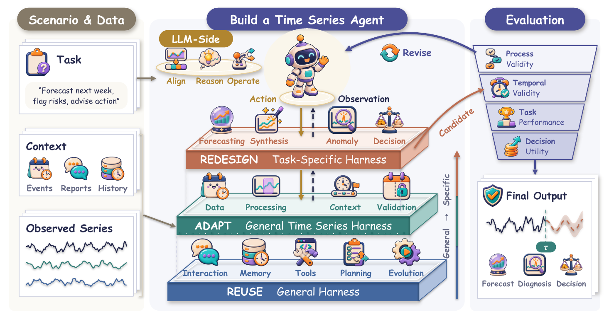
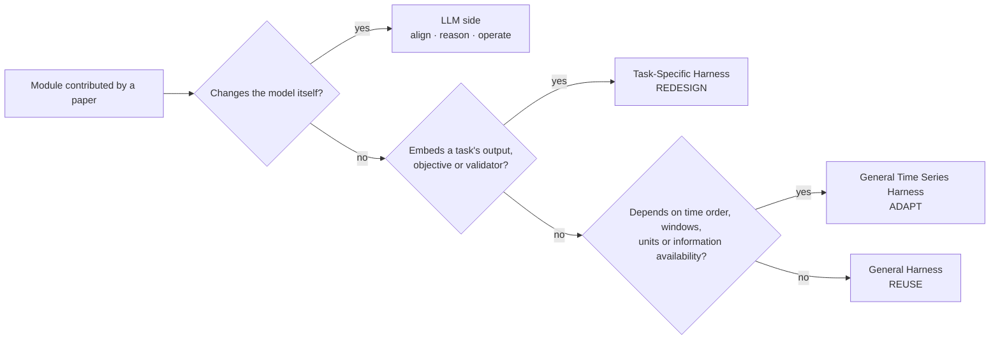
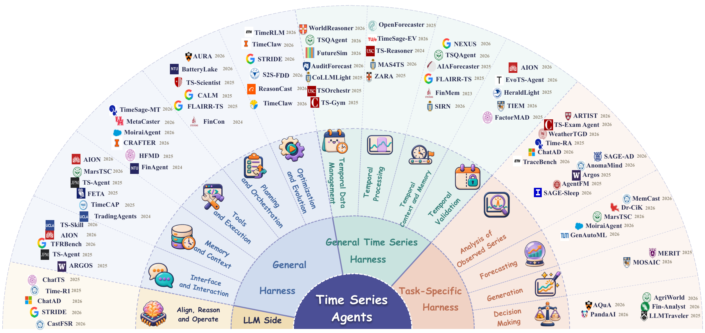
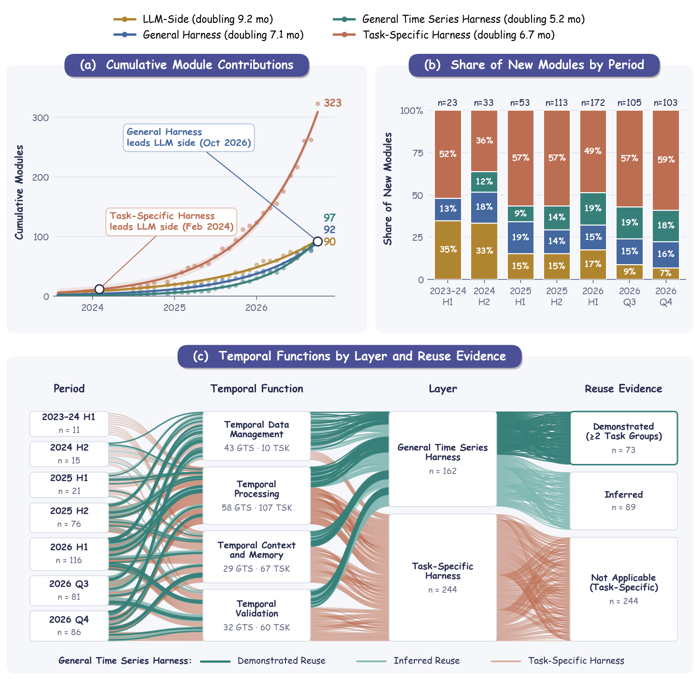

<h1 align="center">Time Series Agents</h1>
<p align="center"><strong>A Survey of LLMs, Harness Architectures, and Evaluation</strong></p>

<p align="center">
  
  
  
  
  
</p>

<p align="center">
  <a href="#-talk-to-the-survey">Talk to the survey</a> ·
  <a href="#-how-a-time-series-agent-is-built">The formula</a> ·
  <a href="#-paper-cards">Paper Cards</a> ·
  <a href="#-what-the-records-show">Findings</a> ·
  <a href="main.tex">Manuscript</a> ·
  <a href="#-contribute">Contribute</a> ·
  <a href="#-citation">Citation</a>
</p>

<p align="center">
  
</p>

> **Build a Time Series Agent for your scenario.** This repository is the survey *and* a machine-readable map of the
> field: every reviewed work is a Paper Card whose modules are classified, quoted from the source, and linked to
> official code and data. Clone it, open a coding agent, and ask.

## 💬 Talk to the survey

The repository is set up to be read by coding agents. [`AGENTS.md`](AGENTS.md) tells the agent how to answer from the
Paper Cards (with page-level evidence) and how to walk you through designing an Agent for your own data.

```bash
git clone https://github.com/Minions-Land/Time-Series-Agents-Survey.git
cd Time-Series-Agents-Survey
claude        # or: codex
```

Then ask, for example:

| Goal | Ask |
|---|---|
| Find mechanisms | *"Which shared modules handle information cutoff or look-ahead leakage? Quote the evidence."* |
| Understand one paper | *"What does AION contribute at each layer, and which parts could I reuse?"* |
| Compare | *"Compare how forecasting Agents implement temporal memory. Which are task-bound?"* |
| **Design an Agent** | *"I forecast hourly electricity load and must flag anomalies for operators. Design a Time Series Agent: what to reuse, adapt and redesign, and how to evaluate it."* |
| Find resources | *"Which benchmarks test temporal validity, and where is their official code?"* |

> [!TIP]
> Without an agent, the same lookups run from the command line:
> `python3 scripts/query_cards.py --layer GTS --function context_memory` lists shared temporal memory modules;
> `--work aion2026` prints one full card; `--stats` gives counts by layer, function and task.

## 🧱 How a Time Series Agent is built

$$\textbf{Time Series Agent} \approx \text{LLM} + \text{General Harness} + \text{Time Series Harness}$$

$$\textbf{Time Series Harness} = \text{General Time Series Harness} + \text{Task-Specific Harness}$$

This formula is the one concept the survey introduces. Each concrete module a paper contributes is assigned to the **most specific** layer whose condition it meets:



Every other label describes one term, and none is a new classification:

| Term | Vocabulary | Basis |
|---|---|---|
| **LLM side** | Temporal representation and alignment · temporal instruction and reasoning · learning to operate temporal workflows | Where the model enters the Agent loop $a_k=\pi_\theta(s_k)$: the state it reads, its parameters, its action policy |
| **General Harness** | Interface and Interaction · Memory and Context · Tools and Execution · Planning and Orchestration · Optimization and Evolution | Synthesized from Agent and Harness research (CoALA, Wang et al., code-harness and agentic-harness surveys) |
| **General Time Series Harness** | Temporal Data Management · Temporal Processing · Temporal Context and Memory · Temporal Validation | The availability record $(x_i,t_i,v_i)$: store it, operate on it over windows, admit outside context, check $v_i\le\tau$ |
| **Task-Specific Harness** | Analysis of Observed Series (classification · imputation · anomaly detection · question answering) · Forecasting · Generation · Decision Making | What the output refers to relative to the current time; task names from TimesNet/TSLib and Time-MQA |
| **Evaluation** | Process Validity · Temporal Validity · Task Performance · Decision Utility | One check per term |

<p align="center">
  
</p>

## 🗂️ Paper Cards

A Paper Card records what a work contributes, module by module, with the passage that supports each decision.

<details>
<summary><strong>Example card (abridged)</strong></summary>

```json
{
  "citation": {"key": "timeclaw2026harness", "title": "Harnessing Generalist Agents for Contextualized Time Series", "arxiv_id": "2606.05404"},
  "module_level_contributions": {
    "review_status": "paper_verified",
    "modules": [{
      "id": "timeclaw2026harness:memory",
      "name": "Signal-text episodic retrieval",
      "layer": "GTS",
      "dimensions": ["Memory and Context"],
      "function_view": {"functions": ["context_memory"]},
      "reuse_evidence": {"level": "demonstrated", "tasks": ["forecasting_prediction", "temporal_question_answering"], "basis": "work"},
      "scope_reason": "Retrieval keys jointly represent temporal signal structure and text context, beyond an ordinary dialogue buffer.",
      "evidence": [{"locator": "PDF p.4; Section 3.4, Episodic Multimodal Memory", "quote": "..."}]
    }]
  }
}
```

</details>

| File | What it is |
|---|---|
| [`paper_classification_ledger.json`](paper_classification_ledger.json) | All cards, generated view used by agents and scripts |
| [`paper_classification_ledger.csv`](paper_classification_ledger.csv) | Maintained source of the cards |
| [`references/taxonomy_schema.json`](references/taxonomy_schema.json) | Controlled vocabulary and field definitions |
| [`references/reviews/20261106_terra_reaudit/rubric_tree.yaml`](references/reviews/20261106_terra_reaudit/rubric_tree.yaml) | Decision tree used to classify every module |
| [`docs/official-resources.md`](docs/official-resources.md) | 117 author-attributed code, data and model links across 91 works |
| [`references/pdf_manifest.csv`](references/pdf_manifest.csv) | Source URL and SHA-256 of every reviewed PDF ([`scripts/fetch_pdfs.py`](scripts/fetch_pdfs.py) refetches them) |
| [`TS_AGENT_HARNESS_SURVEY.bib`](TS_AGENT_HARNESS_SURVEY.bib) | Bibliography of the manuscript |

> [!NOTE]
> Counts are curation counts of a reviewed corpus, not of independently reproduced systems. In November 2026 every
> card was re-audited against the rubric tree, one model run per paper with script-checked verbatim quotes. Flagged
> cases, layer changes and disagreements between coders were then adjudicated
> ([records and briefs](references/reviews/20261106_terra_reaudit/)).

## 📈 What the records show

<p align="center">
  
</p>

- **How to assess a new work.** Place its modules in the formula; check the claimed scope (a general mechanism
  presented as task-specific, or a task procedure presented as general); then read the contribution off the map:
  automation, another implementation, a filled empty cell, or consolidation into a shared time series module.
- **Most works automate; fewer meet a time series requirement under test.** 136 of 162 works automate an analysis.
  Only 70 of the 143 method works test the requirement their modules address (leakage, regime change, data quality,
  context, decision consequences, verifiability or deployment).
- **Generality is often claimed, less often shown.** Reuse across at least two task groups is demonstrated for 89 of
  the 189 General Harness and General Time Series Harness modules; the generality of the rest is inferred from their
  interfaces.
- **Effort is moving from the model to the runtime.** The LLM side supplied about a third of new modules until the
  end of 2024 and 7–18% in each later period. Shared temporal modules grow fastest, doubling about every 5 months.
- **Time series adaptation is mostly tools.** 67 of the 97 General Time Series Harness modules provide tools and
  execution; only 18 plan or orchestrate and 2 optimize the Harness, so temporal workflow control is still written as a
  general mechanism or inside a task. Decision making relies on task modules in every mechanism dimension.
- **Solutions stay inside tasks.** There are 325 task-specific modules for 97 shared temporal ones. Of the module
  links to a tested requirement, 108 of 181 are task modules. Generation has no shared data-management module.

## 🤝 Contribute

[Open an issue](https://github.com/Minions-Land/Time-Series-Agents-Survey/issues) with the paper title and official
URL, the proposed module or correction, a page or section locator, and any official repository or benchmark link.
New works are classified with the same [rubric tree](references/reviews/20261106_terra_reaudit/rubric_tree.yaml).

<details>
<summary><strong>For maintainers: update and check the cards</strong></summary>

```bash
uv run scripts/classification_manager.py sync
uv run --with bibtexparser==1.4.3 python scripts/check_ledger_consistency.py
python3 scripts/sync_reviewed_manuscript.py
latexmk -pdf -interaction=nonstopmode -halt-on-error main.tex
```

See the [curation guide](references/CLASSIFICATION_LEDGER.md) and [maintenance notes](docs/ledger-maintenance.md).
Figure sources (editable PowerPoint and build scripts) are under [`artifacts/unified_v7_20261106/`](artifacts/unified_v7_20261106/).

</details>

## 📝 Citation

```bibtex
@article{ma2026timeseriesagents,
  title   = {Time Series Agents: A Survey of LLMs, Harness Architectures, and Evaluation},
  author  = {Ma, Jiaming and Wan, Shu and Zhu, Hou and Zhu, Rui and Xia, Ruichu and Tan, Jiyuan and
             Ma, Haofeng and Wang, Stephen and Wen, Qingsong},
  year    = {2026},
  note    = {Manuscript and resources: https://github.com/Minions-Land/Time-Series-Agents-Survey}
}
```
